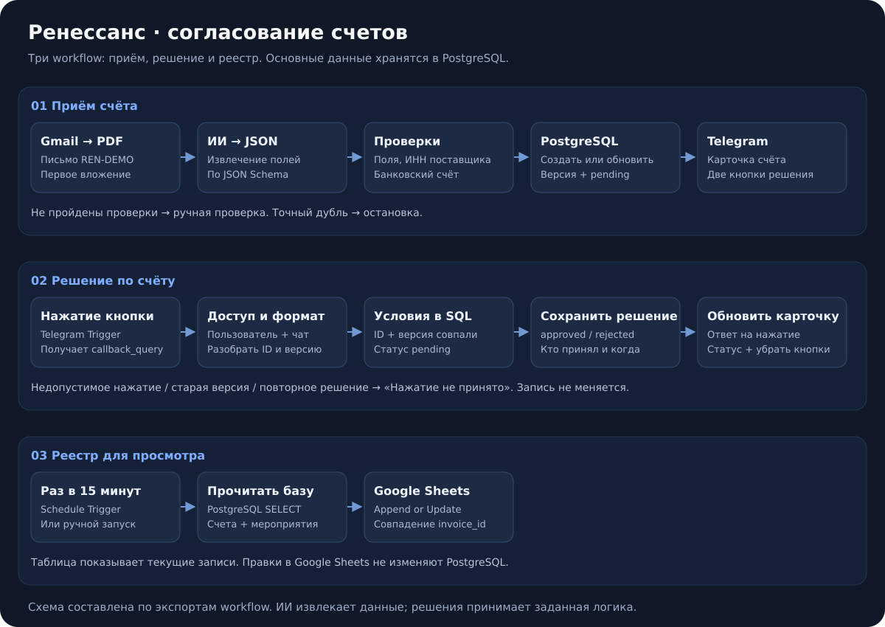
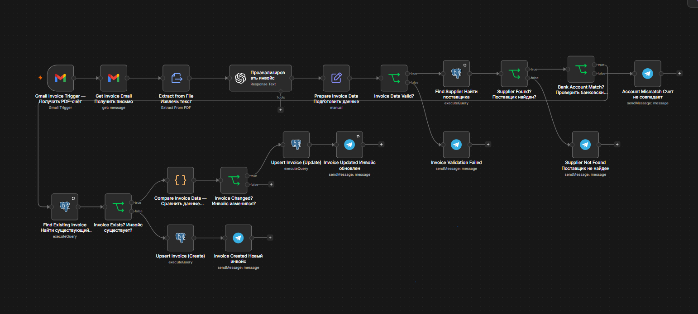
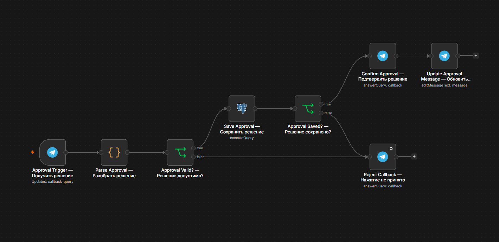
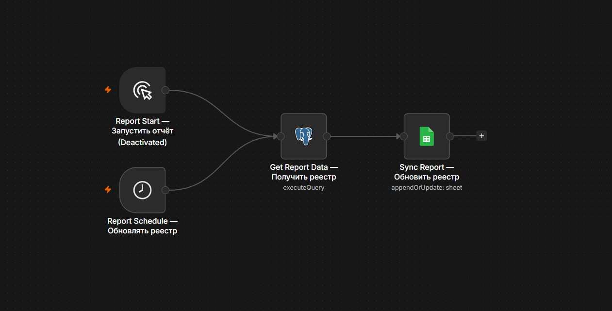

# Renaissance: Invoice Approval in Telegram

[Русская версия](README_RU.md)

A project developed for **[Renaissance](https://renss.ru/aboutcompany)**, a company working on the restoration and reconstruction of engineering networks and the construction and decoration of congress and exhibition events.

Built with **n8n**: receives a PDF invoice from Gmail, extracts data with AI, checks the supplier and bank details, saves the invoice in PostgreSQL, and sends it to Telegram for approval. Google Sheets displays the current register.

The main scenarios have been checked manually. The system handles invoice approval and the register; it does not make payments.

## Demo

https://github.com/user-attachments/assets/9e880288-1291-4bb6-b10c-c9ba1d107944

82-second demo: the n8n workflow, PDF invoice sending, data extraction, Telegram approval, an updated invoice version, and the current Google Sheets register. Final result: RUB 11,000 / v2 / approved. The interface and captions are in Russian.

## Business Problem

An invoice arrives by email. Someone needs to check who sent it, whether the bank details have changed, whether it has already been processed, and who made the decision. The automation connects these steps and stops questionable cases for manual review.

## How It Works

| Workflow | Purpose | Trigger |
| --- | --- | --- |
| [Invoice intake](workflows/invoice-intake.json) | Extracts data, checks bank details, creates or updates a record, and sends approval buttons | Gmail, polled once a minute |
| [Invoice decisions](workflows/invoice-approvals.json) | Checks the user, version, and status; saves the decision; updates the message | Telegram button click |
| [Report](workflows/invoice-report.json) | Adds or updates Google Sheets rows by `invoice_id` | Every 15 minutes |

Intake and decision handling use **one Telegram bot**. Intake sends the buttons, and the Telegram Trigger in the decisions workflow receives clicks. The report reads data from PostgreSQL.

## Workflow Screenshots

### 1. Invoice Intake and Processing

Receives a PDF from Gmail, extracts data, and checks the supplier, bank account, and duplicates. A new invoice is saved; changed data increases the version and triggers another Telegram approval. An exact duplicate stops without a new message.

### 2. Invoice Decisions in Telegram

Receives a button click and checks the user and chat. Saves a decision only for the current version with a `pending` status, then updates the message. Old buttons and repeated decisions for the same version are rejected.

### 3. Google Sheets Report

Every **15 minutes**, reads the current data from PostgreSQL and updates the register. Finds an existing row by `invoice_id` or adds a new one, so repeated exports do not create duplicates.

## Example

1. A new invoice for **RUB 10,000** arrives → version **1**, status `pending`, Telegram buttons.
2. The same document is sent again → no changes and no new message.
3. The same invoice number arrives for **RUB 11,000** → version **2**, status returns to `pending`.
4. A version 1 button is clicked → rejected because it refers to old data.
5. Version 2 is approved → `approved`; the user and time are saved; buttons are removed.
6. Another decision is attempted for version 2 → rejected because it has already been reviewed.
7. The next report run updates the same Google Sheets row.

The example above uses fictional amounts. Checks on the configured test environment are described separately in the [test results](docs/test-results.md).

## Rules

- The supplier is looked up by **tax ID (INN)** in the PostgreSQL reference table.
- The bank account extracted from the PDF must match the reference table.
- An invoice is identified by **supplier tax ID + invoice number**.
- An exact duplicate does not update the record or increase the version.
- Changed data increases the version and resets the decision, approver, and approval time.
- A decision is saved only when **ID + version + `pending` status** match.
- An unknown supplier, incomplete data, or mismatched bank details triggers a manual-review notification.
- AI extracts fields. IF nodes, JavaScript, and SQL perform checks and record decisions.

`pending` means awaiting a decision, `approved` means approved, and `rejected` means rejected. The separate `status = processed` field describes document processing and does not mean approval.

## Verified Scenarios

| Scenario | Result |
| --- | --- |
| Unknown supplier | Notification; invoice not saved |
| New invoice | Version 1, awaiting approval, buttons |
| Exact duplicate | Stops without updating or sending a new message |
| Amount change | New version, renewed approval |
| Old button | Decision not applied |
| Approval and rejection | Decision saved, message updated |
| Repeated decision for the same version | Access check passes; saving is rejected |
| Bank account mismatch | Stops before saving; notification text corrected |
| Repeated Google Sheets export | Same row updated without duplicates |
| Click from another Telegram account | Check implemented; not yet tested manually |

## Running the Demo

The repository includes three sanitized JSON exports, [schema and seed data](sql/), [fictional PDFs](demo/), and [step-by-step setup instructions](docs/setup.md).

Credentials and personal IDs have been removed. Workflows are inactive; connect your accounts and replace `YOUR_...` before running them. The original workflow logic is preserved. The database schema was reconstructed from queries rather than exported from the working database.

## Limitations

- Processes the first attachment, `attachment_0`; scanned PDFs need separate OCR.
- Exhibition and category are set manually in the data preparation node.
- The current required-field check relies on the model's `missing_fields`; independent value validation is needed. `document_type` is extracted, but the export does not explicitly block `not_invoice`.
- PostgreSQL stores the current version. A complete version and decision history is not implemented.
- The register updates on a schedule: a Telegram change does not mean an instant Google Sheets change. Manual sheet edits do not change the database; rows deleted from the database are not automatically removed from the register.
- A late arrival of an old PDF may count as another change: version protection applies to buttons, not email order.
- Simultaneous arrivals, concurrent updates, and API error recovery have not been tested. Saving to PostgreSQL and notifying Telegram are not a single transaction.
- Processing-time reductions have not been measured; the system does not replace accounting software.

## Author

**Alexander Zaytsev**

AI Automation Engineer

* GitHub: https://github.com/AlexZaytsev-ai
* Email: [polonix315@gmail.com](mailto:polonix315@gmail.com)

Technologies: **n8n · Gmail · OpenAI · PostgreSQL · Telegram Bot API · Google Sheets · JavaScript · SQL**.
